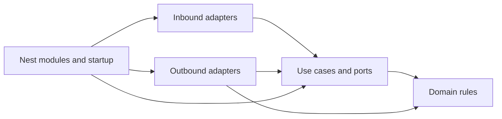

# Backend architecture

Working draft. Migration steps and progress are in [plan.md](plan.md).
This file explains the structure, where code belongs, and the business rules.

## 1. Goal and choices

Keep business rules testable without NestJS, Postgres, or Claude.

Agreed: organize by feature, put actions in `application/use-cases/`, and put
common technical code in `shared/`. The proposed starting stack stays TypeScript,
NestJS, Prisma, Postgres, and `node:test`, in one application.

Framework changes, new APIs, a different AI provider, and durable background jobs
are separate decisions. Ask when a choice about behavior or scope is unclear.

## 2. Layers and responsibilities

| Part                     | Job                                                       |
| ------------------------ | --------------------------------------------------------- |
| `domain/`                | Business data and rules: what is allowed and what changes |
| `application/use-cases/` | Steps for one action, such as SaveResume                  |
| `application/ports/`     | Interfaces for work the use case needs                    |
| `adapters/inbound/`      | Start a use case from HTTP, a worker, or a command        |
| `adapters/outbound/`     | Do work requested through a port: database, AI, files     |
| `shared/`                | Common settings, connections, and technical helpers       |
| `*.module.ts`, `main.ts` | Connect implementations and start the app                 |

A use case is an application service. A reusable business rule can be a domain
service or a plain function. Keep related rules together; each rule does not
need its own class or file. Feature modules are the business areas.

## 3. Dependency rules

The [Clean Architecture dependency rule](https://blog.cleancoder.com/uncle-bob/2012/08/13/the-clean-architecture.html)
keeps technical details outside business logic.



Arrows show source imports. At runtime, a use case calls a port and an adapter
does the work.

- Domain and application code use plain TypeScript. Keep Nest decorators,
  Prisma models, HTTP objects, and concrete adapters out, including type imports.
- Inbound adapters validate requests and map responses/errors. Outbound adapters
  handle external formats and I/O: database, network, files, and processes.
- Each feature owns its data access. To use another feature, define a local port
  and connect it to that feature's public API through an adapter.
- `contracts.ts` exports only the plain data and operations other features need.
  Keep Nest tokens and wiring separate. Avoid circular module imports.
- `shared/` technical code contains no feature rules or feature imports. A use
  case uses a port instead of importing the shared Prisma or Claude runner.
- Nest [factory providers](https://docs.nestjs.com/fundamentals/custom-providers)
  create use cases and supply their adapters. Make dependencies explicit.

## 4. Proposed structure

One reference module shows where different file types belong. Use this pattern
for other features. Create only what is needed; the examples do not add features
to the rewrite.

### Application and shared code

```text
backend/
  src/
    main.ts                              # start the server
    app.module.ts                        # connect feature modules
    shared/
      config/environment.ts              # read and validate settings
      config/config.module.ts
      database/prisma.service.ts         # connection and lifecycle
      database/database.module.ts
      http/zod-validation.pipe.ts
      http/application-error.filter.ts   # application errors -> HTTP
      http/text.schema.ts
      http/request-logging.interceptor.ts
      ai/claude-process.runner.ts        # execution, limits, cleanup
      ai/json.ts                         # model-output parsing helper
      ai/ai.module.ts
    modules/jobs/                        # reference module below
  prisma/
    schema.prisma                        # database model definitions
    migrations/                          # keep existing history
  test/
    unit/                                # domain and use cases
    integration/                         # real database and adapters
    http/                                # routes, auth, responses
    architecture/                        # imports and module cycles
    fixtures/                            # synthetic documents and AI output
```

### One reference module: possible file types

All paths below are inside `backend/src/modules/jobs/`. Optional files are
examples for future needs, not a required list of empty files.

```text
jobs/
  domain/
    job.ts                               # entity: business data and rules
    job-url.ts                           # value object: validated value
    job-status.ts                        # business states and types
    job.factory.ts                       # create a valid business object
    captured-field.policy.ts             # decision, e.g. protect edits
    job-ranking.service.ts               # rules involving several objects
    job.errors.ts                        # rule failures
    events/job-status-changed.event.ts    # business-event data

  application/
    use-cases/
      capture-job.ts                     # one action; execute(input)
      capture-job.types.ts               # input/output, if a split helps
      get-job.ts
    dto/job-summary.ts                   # result shared by use cases
    services/job-reading.service.ts       # steps shared by use cases
    ports/
      job-repository.ts                  # read/write business data
      job-unit-of-work.ts                # one transaction across repositories
      job-page-extractor.ts              # request external extraction
      job-read-scheduler.ts              # request background work
      resume-link-reader.ts              # request data from another feature
      file-storage.ts
      event-publisher.ts
      clock.ts                           # supply time for business decisions
      id-generator.ts
    event-handlers/on-job-status-changed.ts
    errors.ts                            # access, missing data, conflicts

  adapters/
    inbound/                             # calls into the application
      http/
        jobs.controller.ts
        dto/capture-job.request.dto.ts   # HTTP request
        dto/job.response.dto.ts          # HTTP response
        jobs.schemas.ts                  # Zod validation
        jobs.presenter.ts                # result -> response
        job-owner.guard.ts               # HTTP access check
        jobs.interceptor.ts              # feature-specific HTTP handling
      worker/job-read.worker.ts
      cli/capture-job.command.ts
      messaging/job-message.consumer.ts

    outbound/                            # implements application ports
      persistence/
        prisma-job.repository.ts         # queries and writes
        prisma-job-unit-of-work.ts       # transaction implementation
        job.mapper.ts                    # database <-> business data
        job.queries.ts                   # complex query helpers
      ai/
        claude-job-page.extractor.ts
        page-reader.prompt.ts
        page-reader.parser.ts            # provider output -> plain data
      http/job-board.client.ts           # outgoing API call
      documents/pdf-text.extractor.ts
      storage/local-file.storage.ts
      scheduling/in-process-job-read.scheduler.ts
      cache/cached-job.reader.ts
      events/job-event.publisher.ts
      modules/resume-link.reader.ts      # another feature's public API

  contracts.ts                           # public data and operations
  jobs.tokens.ts                         # Nest interface-binding tokens
  jobs.module.ts                         # connect use cases and adapters
```

Placement notes:

- **DTOs** carry data. HTTP DTOs stay in the HTTP adapter; use-case inputs/outputs
  stay with the use case. Shared application shapes can use `application/dto/`.
  With Zod, a request type can live in its schema file. Avoid duplicate shapes.
- **Database types** come from Prisma. Map them to business types in the adapter.
  Feature repositories own queries; the shared database service owns the connection.
- **Unit of work** means one atomic operation across repositories. A single
  atomic repository method may be enough without a separate unit-of-work object.
- **Services** share rules in domain or steps in application. **Events** are data
  in domain, reactions in application, and transport code in adapters.
- Add caching, events, extra services, or a durable queue when an actual need
  appears. The folder guide does not select a new library or service.

## 5. Existing business logic and its home

| Area                  | Current code and proposed home                                                                                                                                                                                                                                                                                          |
| --------------------- | ----------------------------------------------------------------------------------------------------------------------------------------------------------------------------------------------------------------------------------------------------------------------------------------------------------------------- |
| Auth                  | [AuthService](../backend/src/auth/auth.service.ts) becomes sign-in/account use cases with Google and database adapters. Token methods move from ProfileService to auth. Keep Google's stable subject as account identity.                                                                                               |
| Profiles              | [ProfileService](../backend/src/profile/profile.service.ts) becomes EnsureProfile/GetProfile/UpdateProfile. Contact rules stay here; career data comes from resumes through a port.                                                                                                                                     |
| Jobs                  | [JobsService](../backend/src/jobs/jobs.service.ts), [JobCaptureService](../backend/src/jobs/job-capture.service.ts), and [JobReaderService](../backend/src/jobs/job-reader.service.ts) split into use cases, URL/edit/status rules, and database/extraction/worker adapters.                                            |
| Resumes               | [ResumeService](../backend/src/resume/resume.service.ts) and [DiffService](../backend/src/resume/diff.service.ts) split into use cases, pure revision/diff/copy rules, a document builder, and database adapters. Prisma filters and version-row details stay in persistence.                                           |
| Tailoring             | [TailorResumeService](../backend/src/resume/tailor-resume.service.ts), [RewriteService](../backend/src/resume/rewrite.service.ts), and [helpers](../backend/src/resume/tailoring/index.ts) split into use cases, claim/suggestion rules, and AI adapters. Prompts, JSON/Zod parsing, and provider IDs stay in adapters. |
| CV import             | [ImportService](../backend/src/import/import.service.ts) coordinates file reading and transcription through ports. [ExtractService](../backend/src/import/extract.service.ts) becomes document adapters; draft/missing-field rules stay in this feature.                                                                |
| Shared technical code | [LlmService](../backend/src/llm/llm.service.ts) becomes the shared Claude runner; [PrismaService](../backend/src/prisma/prisma.service.ts) manages the shared connection. Neither owns business rules.                                                                                                                  |

Key connections:

- Profiles reads identity from auth and career data from resumes through ports.
  Resumes needs only stored-profile access. Wire the combined profile HTTP view
  at the root, keeping stored-profile wiring independent to avoid a cycle.
- Tailoring uses public job/resume operations. Resumes owns copies and pending
  proposal storage; tailoring owns generation and checking. Keep `Resume.tailoring`
  storage initially. Jobs reads associated resume IDs through a resume query.
- Domain rules decide changes; adapters apply them. Resume assembly and conversion
  are plain application helpers. Generate IDs outside pure copy rules.
- Current routes can stay in place while code moves between feature modules.

## 6. Business and data rules

Preserve these rules during the rewrite. Discuss any behavior change separately.

- **Access:** use a trusted user ID from session/bearer auth. Use cases and data
  access must check ownership, including history, copies, and rebuilds. Keep
  existing 401 and cross-user 404 responses.
- **Profiles:** updating contact details does not change saved resume headers.
- **Resume saves:** omitted sections stay unchanged. A supplied list replaces
  that section; missing entries are removed. Match stable lineage IDs and summary
  variant keys. Preserve order, role/bullet links, optional metadata and defaults.
- **History:** unchanged saves add no snapshot; revert adds a new one. Save rows,
  snapshot and derived current document in one transaction. The current document
  can be rebuilt from versioned rows. Keep IDs, snapshot numbers and validity ranges.
- **Copies:** use fresh lineage IDs while keeping bullets linked to copied roles.
  Keep the source unchanged. Reuse an existing job copy before considering a new
  `sourceResumeId`. Deleting a job removes events and unlinks copies, not the resumes.
- **Job edits:** capture updates the same canonical URL per user and protects
  edited fields. A combined field/status edit stays one atomic action.
- **Status:** any valid status is allowed; same-status saves add no event. Undo
  only the latest move by removing that event and restoring its previous status.
- **AI:** return drafts/proposals for review. Keep AI calls outside database
  transactions; [Prisma recommends short transactions](https://www.prisma.io/docs/orm/v6/prisma-client/queries/transactions).
  Preserve timeouts, tool/environment isolation, fallback originals and pending recovery.
- **Review:** [the frontend](../frontend/src/resume/applyTailoring.ts) currently
  applies accepted suggestions, hidden bullets and order before generic resume save.
  Its review page blocks stale proposals. Moving acceptance to the server is separate work.

Current limits to keep visible:

- Claim checks compare names/numbers, not meaning or level of ownership. Import
  and single-line rewrite rely on instructions and review, without this checker.
- The tailoring prompt asks for two bullets when available; code ensures one remains.
- Career years are current year minus earliest start year, without removing gaps.
- Manual creation protects title/company; a supplied location is not marked protected.

Keep API behavior and stored data stable as described in [the rewrite plan](plan.md).
